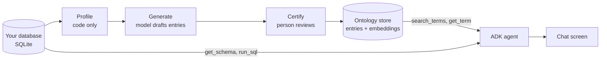

# Ontology Chat

**Your database → an automatically generated ontology → an ADK agent that uses it as a tool.**

Ontology Chat is an end-to-end working solution that shows what an ontology layer does for an AI agent that writes SQL. The ontology tells the model what your columns and codes actually mean, so it stops guessing.


In the recording the question is *"Which district has the highest average salary, and what is it?"* The salary column in this database is named `A11`.

| Chat mode | Ontology comes from | Answer |
|---|---|---|
| Generated | This app's generator | **Hl.m. Praha, 12,541** (correct) |
| NVIDIA library | A running [NVIDIA Auto Ontology](https://github.com/NVIDIA/auto-ontology) stack | **Hl.m. Praha, 12,541** (correct) |
| Baseline | Nothing, raw schema only | "100.0" (wrong column) |

The full stack is included: a chat screen, a streaming API, a [Google ADK](https://google.github.io/adk-docs/) agent on an [Ollama](https://ollama.com/) model, embedding search over the ontology, and read-only SQL execution. No API keys are needed, including no NVIDIA key.

## Contents

- [The flow in three commands](#the-flow-in-three-commands)
- [How it works](#how-it-works)
- [Installation, step by step](#installation-step-by-step)
- [Generate the ontology automatically](#generate-the-ontology-automatically)
- [Use your own database](#use-your-own-database)
- [Use the NVIDIA Auto Ontology library](#use-the-nvidia-auto-ontology-library)
- [Settings](#settings)
- [Project layout](#project-layout)
- [Troubleshooting](#troubleshooting)
- [Results and limits](#results-and-limits)
- [Credits](#credits)

## The flow in three commands

After [installation](#installation-step-by-step):

```
# 1. point at a SQLite database (skip this to use the demo database)
$env:DB_PATH = "C:\path\to\mydata.sqlite"

# 2. generate, certify and publish the ontology
uv run python scripts/generate_ontology.py --use-docs --certify-all --publish

# 3. start the app and ask
uv run uvicorn app.server:app --port 8765
```

Open http://127.0.0.1:8765 and choose **Generated** in the chat.

## How it works



An ontology entry is one of three kinds:

| Kind | What it captures | Example |
|---|---|---|
| `term` | A business concept mapped to columns and coded values | "Average salary" is `district.A11` |
| `sql_attribute` | A reusable calculation | "Problem loan" is `loan.status IN ('B', 'D')` |
| `relationship` | How tables join | Clients reach accounts only through `disp` |

The agent is given four tools. A chat mode is simply a choice of which ontology the first two tools read.

| Tool | What it does |
|---|---|
| `search_terms(query)` | Finds the closest ontology entries by embedding search |
| `get_term(term_id)` | Reads one entry in full: columns, code meanings, SQL |
| `get_schema()` | Lists tables and columns, with no meanings |
| `run_sql(sql)` | Runs one read-only query and returns up to 50 rows |

| Chat mode | `search_terms` and `get_term` read from |
|---|---|
| **Generated** | Entries this app drafted from the database and a person certified |
| **Hand-written** | A YAML file written by hand, kept as a reference point |
| **NVIDIA library** | The ontology inside a running NVIDIA Auto Ontology stack, fetched live |
| **Baseline** | Nothing. The agent only has `get_schema` and `run_sql` |

## Installation, step by step

Tested on Windows 11. The commands are the same on macOS and Linux.

### Step 1. Install the two prerequisites

| Tool | What it is for | Install |
|---|---|---|
| [uv](https://docs.astral.sh/uv/getting-started/installation/) | Installs Python 3.12 and the project's packages | Windows: `winget install astral-sh.uv` |
| [Ollama](https://ollama.com/download) | Runs the chat and embedding models | Download the installer from ollama.com |

You do not need to install Python yourself. Check both tools respond:

```
uv --version
ollama --version
```

### Step 2. Pull the models

```
ollama pull qwen3.5:9b
ollama pull bge-m3
```

This downloads about 8 GB. `qwen3.5:9b` is the chat model and `bge-m3` creates the embeddings. An 8 GB GPU is enough.

### Step 3. Get the code and install packages

```
git clone https://github.com/rickragv/ontology-layer.git
cd ontology-layer
uv sync
```

### Step 4. Download the demo database

```
uv run python scripts/load.py
```

This downloads the [BIRD](https://bird-bench.github.io/) dev set (about 350 MB) and extracts its `financial` database into `data/`: a real Czech bank with 8 tables and about a million transactions. District columns are named `A2` to `A16` and values are Czech codes, which makes it a good test.

### Step 5. Build the ontologies

```
uv run python scripts/generate_ontology.py --use-docs --certify-all --publish
uv run python scripts/build_ontology.py
```

The first command generates the ontology automatically (about 13 minutes on an 8 GB GPU). The second builds the hand-written reference from `ontology/financial.yaml`.

### Step 6. Start the app

```
uv run uvicorn app.server:app --port 8765
```

Open **http://127.0.0.1:8765**. The status line next to the title shows the model and how many entries each ontology has. The first question takes about 30 seconds longer than later ones while Ollama loads the model.

## Generate the ontology automatically

The **Build ontology** screen and `scripts/generate_ontology.py` run the same four stages.

| Stage | Done by | What happens |
|---|---|---|
| 1. Profile | Code, no model | Reads every table: row counts, column types, distinct counts, common values. Flags coded and cryptic columns and finds likely joins by matching values. |
| 2. Generate | The model | Drafts terms, relationships and calculations from the profile. Every column reference and SQL snippet is checked against the database. |
| 3. Certify | A person | Approve, edit or reject each draft, with the sample values it came from shown beside it. |
| 4. Publish | Code | Embeds the certified entries, makes them searchable, and writes them to `ontology/generated.yaml`. |

Drafts and rejected entries are never searchable. The agent only sees what was certified and published.

### Why the certify stage exists

A model can see that `loan.status` holds A, B, C and D. It cannot know what C means unless something tells it. Measured on the demo database:

| | Without documentation | With documentation |
|---|---|---|
| Drafts produced | 39 | 43 |
| Flagged "needs review" | 29 | 7 |
| `district.A11` | "Unknown integer value", flagged | "Average salary" |
| `loan.status` | "'C' = cancelled (likely)", flagged | "'C' = running contract, OK so far" |

Documentation is optional plain text, one file per table (`<table>.csv`, `.md` or `.txt`) in the folder set by `DOCS_DIR`. Turn it on with `--use-docs` or the switch on the Generate stage.

Entries where the model guessed are flagged with a note saying what to confirm. `--certify-all` and the "Certify all" shortcut skip that review. They are useful for a first look, and answers that depend on a guessed code can then be wrong.

### Command-line options

```
uv run python scripts/generate_ontology.py                  # profile and draft only
uv run python scripts/generate_ontology.py --use-docs       # also read DOCS_DIR
uv run python scripts/generate_ontology.py --use-docs --certify-all --publish
```

## Use your own database

The app works on any **SQLite** file, with no code changes.

### Step 1. Have your data in a SQLite file

If it is not already SQLite, export tables to CSV and load them:

```
sqlite3 mydata.sqlite
.mode csv
.import orders.csv orders
.import customers.csv customers
```

The app opens the file read-only and refuses anything except `SELECT`.

### Step 2. Point the app at it

PowerShell:

```powershell
$env:DB_PATH = "C:\path\to\mydata.sqlite"
$env:GENERATED_DB = "data\mydata-generated.db"
$env:GENERATED_YAML = "ontology\mydata.generated.yaml"
$env:DB_NOTES = "Order data for an online shop: tables orders and customers. Amounts are in INR."
```

macOS or Linux:

```bash
export DB_PATH=/path/to/mydata.sqlite
export GENERATED_DB=data/mydata-generated.db
export GENERATED_YAML=ontology/mydata.generated.yaml
export DB_NOTES="Order data for an online shop: tables orders and customers. Amounts are in INR."
```

`DB_NOTES` is one or two sentences telling the agent what the database is. If you have column documentation, put one file per table in a folder and set `DOCS_DIR` to it.

### Step 3. Generate, then run

In the same terminal:

```
uv run python scripts/generate_ontology.py --use-docs --certify-all --publish
uv run uvicorn app.server:app --port 8765
```

For a careful result, leave out `--certify-all --publish`, open **Build ontology**, and review the drafts there before publishing.

### Step 4. Improve it from what you see

| What you see in chat | What to change in Build ontology |
|---|---|
| The right entry is missing from the search results | Edit the entry and add the user's wording to its synonyms |
| Found the entry, wrote the wrong filter | Spell out exact values and case in the description and SQL |
| Wrong join, or duplicate rows | Fix or add a relationship entry |
| A code is explained wrongly | Correct it, certify, publish again |

### Other databases

Only SQLite is supported today. To use another database, replace two functions in `app/tools.py`: `_financial_conn()`, which opens the connection, and `get_schema()`. The profiler in `app/generator.py` also uses SQLite. This path is not built or tested.

## Use the NVIDIA Auto Ontology library

The **NVIDIA library** chat mode connects the ADK agent to a running [NVIDIA Auto Ontology](https://github.com/NVIDIA/auto-ontology) stack. The stack generates and stores the ontology. This app's `search_terms` and `get_term` tools fetch it live over the stack's REST API. Nothing is copied into this repository.

### Running the stack on Ollama models

NVIDIA's stack is built for NVIDIA-hosted models. It ran here on Ollama alone with one small patch and configuration changes. The files are in [`docs/auto-ontology-on-ollama/`](docs/auto-ontology-on-ollama/).

| Change | Why |
|---|---|
| `01-llm-reasoning-effort.patch` (3 lines) | Lets `LLM_REASONING_EFFORT=none` switch off the model's thinking mode: 1 second per call, down from 20 to 28 |
| `Modelfile.qwen3.5-ao` | An Ollama alias named `openai/qwen3.5-ao:9b` with a 16k context. The `openai/` prefix makes the stack use its OpenAI client |
| `init_vdb_1024.py`, run once before the first ingest | The stack creates its vector tables at 2048 dimensions. `bge-m3` produces 1024 |
| `docker-compose.override.yml` | Binds every port to 127.0.0.1 and moves them to 3200 to 3203 |
| All five model settings in `.env` set explicitly | Unset ones fall back to NVIDIA endpoints |
| Clone with `git config core.autocrlf false` on Windows | CRLF line endings break the container entrypoint |
| Name the SQLite file `main.sqlite` | Works around a table-naming bug that produces `financial.main.loan`, which SQLite rejects |

Model settings used in the stack's `.env`:

```
DEFAULT_MODELS_ENDPOINT=http://host.docker.internal:11434/v1
DEFAULT_MODELS_API_KEY=ollama
DEFAULT_MODELS_MODEL=openai/qwen3.5-ao:9b
EMBED_ENDPOINT=http://host.docker.internal:11434/v1
EMBED_API_KEY=ollama
EMBED_MODEL=bge-m3
LLM_REASONING_EFFORT=none
```

Set the `REASONING_*` and `NON_REASONING_*` triplets to the same values as `DEFAULT_MODELS_*`.

### Connecting this app to the stack

Start the app with the stack's address and API token in the environment. The token is the stack's `AUTO_ONTOLOGY_API_TOKEN`. Keep it out of this repository.

```powershell
$env:AUTO_ONTOLOGY_URL = "http://127.0.0.1:3200"
$env:AUTO_ONTOLOGY_API_TOKEN = "<the stack's API token>"
uv run uvicorn app.server:app --port 8765
```

The status line shows the number of library terms when the stack is reachable. The stack must have ingested the same database that `DB_PATH` points at.

### What the library generated

For the demo database, in about 6 minutes: 8 terms (one per table), 47 column definitions and 8 joins. It produced no SQL calculations, because it derives those from query history and SQLite has none.

From the schema alone it did not decode the cryptic columns either. It described `A11` as a count. With the column documentation loaded into its catalog, the definitions were correct.

## Settings

All settings are environment variables. Every one has a default, so the demo runs with none set.

| Variable | Default | Meaning |
|---|---|---|
| `CHAT_MODEL` | `qwen3.5:9b` | Ollama chat model |
| `EMBED_MODEL` | `bge-m3` | Ollama embedding model |
| `OLLAMA_BASE_URL` | `http://127.0.0.1:11434` | Ollama address |
| `DB_PATH` | `data/financial.sqlite` | SQLite database the agent queries |
| `DB_NOTES` | From the dataset notes file | What the agent is told about the database |
| `DOCS_DIR` | `data/database_description` | Optional per-table documentation for the generator |
| `GENERATED_DB` | `data/generated.db` | Generated ontology: profiles, drafts and published entries |
| `GENERATED_YAML` | `ontology/generated.yaml` | Where publishing writes the certified entries |
| `ONTOLOGY_YAML` | `ontology/financial.yaml` | Hand-written ontology source |
| `ONTOLOGY_DB` | `data/ontology.db` | Store built from the hand-written ontology |
| `DATASET_META` | `<ONTOLOGY_YAML>.meta.yaml` | Dataset notes and starter questions |
| `AUTO_ONTOLOGY_URL` | `http://127.0.0.1:3200` | NVIDIA Auto Ontology stack address |
| `AUTO_ONTOLOGY_API_TOKEN` | empty | API token for that stack |

Nothing about a particular dataset lives in the code. The demo's description and starter questions are in `ontology/financial.meta.yaml`.

Publish again after changing `EMBED_MODEL`, because vectors from different models cannot be compared.

## Project layout

```
app/
  config.py            paths and settings
  generator.py         profile, generate, certify, publish
  tools.py             search_terms, get_term, get_schema, run_sql
  library_tools.py     search_terms and get_term backed by an Auto Ontology stack
  agents.py            the four ADK agents and their instructions
  server.py            FastAPI app and the streaming endpoints
ontology/
  generated.yaml       certified entries of the generated ontology
  financial.yaml       hand-written reference ontology (26 entries)
  financial.meta.yaml  notes and starter questions for the demo database
scripts/
  load.py              downloads the demo database
  generate_ontology.py runs the generation flow from the command line
  build_ontology.py    embeds the hand-written YAML
static/
  index.html           chat and Build ontology screens, one file, no build step
docs/
  demo.gif
  auto-ontology-on-ollama/   patch and config for running NVIDIA's stack on Ollama
```

The API, for building another client:

- `GET /api/health`, `GET /api/suggestions`, `GET /api/ontology?source=curated|generated|library`
- `POST /api/chat` with `{"session_id", "message", "mode": "generated" | "ontology" | "library" | "baseline"}`. The response is a server-sent event stream of `tool_call`, `tool_result`, `text` and `error` events, ending with `done`.
- `GET /api/gen/state`, `POST /api/gen/profile`, `POST /api/gen/generate` (event stream), `PATCH /api/gen/entries/{id}`, `POST /api/gen/entries/bulk`, `POST /api/gen/publish`, `POST /api/gen/reset`

## Troubleshooting

| Problem | Fix |
|---|---|
| Status shows "Ollama unreachable" | Start Ollama (`ollama serve`, or open the Ollama app) |
| Status shows "Database unavailable" | Run `scripts/load.py`, or check `DB_PATH` |
| Generated mode says nothing is published | Run the generate command with `--publish`, or publish from Build ontology |
| NVIDIA library mode says the stack is not running | Start the stack, and check `AUTO_ONTOLOGY_URL` and `AUTO_ONTOLOGY_API_TOKEN` |
| `address already in use` on start | Another program holds the port. Stop it, or use `--port 8770` |
| First answer is very slow | Normal. Ollama is loading the model |
| Page looks unchanged after an update | Hard refresh with Ctrl+Shift+R |

## Results and limits

Measured with `qwen3.5:9b` on the demo database. Each question has a known correct answer.

| Ontology | Questions fully correct | Time per answer |
|---|---|---|
| Hand-written | 6 of 6 | 8 to 31 seconds |
| Generated, with documentation, all drafts certified unreviewed | 2 of 4, plus 2 partly right | 9 to 35 seconds |
| NVIDIA library, with documentation | 4 of 5 | 12 to 61 seconds |
| Baseline | 0 of 6 | 45 seconds to 5 minutes |

Read these numbers with care:

- **Small samples, and different question sets per row.** They show the pattern, not a benchmark score. Accuracy on the 53 held-out BIRD questions has not been measured.
- **"Partly right" means a right number from incomplete SQL,** or a right value with the name missing. Some correct answers were lucky in the same way, for example a missing filter that happened not to change the count.
- **Generated ontologies are weaker than a careful hand-written one.** They explain columns one table at a time and miss cross-table rules. Reviewing and editing the drafts closes much of that gap. `--certify-all` does not.
- **Documentation can be wrong.** The generator trusts it. One documented entry in the demo came out with the opposite meaning and was not flagged.
- **The model is not deterministic.** The same question can produce different SQL on another run. Always check the SQL panel.
- **This is not hardened for production.** There is no login, chat history is kept in memory, and only SQLite is supported.

## Credits

- [NVIDIA Auto Ontology](https://github.com/NVIDIA/auto-ontology) (Apache-2.0) is the project this follows. The generator in `app/generator.py` is this project's own code written after the same flow. The NVIDIA library chat mode uses the real stack. The patch in `docs/auto-ontology-on-ollama/` modifies one of its files.
- The demo data comes from the [BIRD benchmark](https://bird-bench.github.io/). It is downloaded by `scripts/load.py` and is not included in this repository. Check BIRD's licence before redistributing it.
- Built with [Google ADK](https://google.github.io/adk-docs/), [LiteLLM](https://github.com/BerriAI/litellm), [FastAPI](https://fastapi.tiangolo.com/) and [Ollama](https://ollama.com/).
