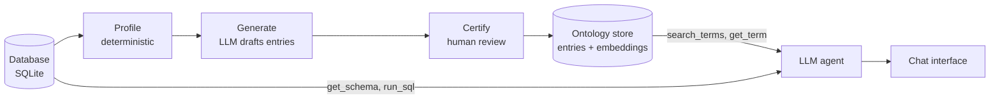

# Ontology Layer

**A semantic layer for text-to-SQL agents.** Generate a business ontology from a database, review it, and expose it to an LLM agent as tools.

[](LICENSE)


LLM agents write incorrect SQL when a schema does not explain itself: columns named `A11`, status codes such as `C`, joins that must pass through a bridge table. Ontology Layer captures that knowledge once, as searchable entries, and gives the agent tools to look it up before it writes a query.


The recording asks *"Which district has the highest average salary, and what is it?"* against a database where the salary column is named `A11`.

| Chat mode | Ontology source | Answer |
|---|---|---|
| Generated | Built-in generator | **Hl.m. Praha, 12,541** (correct) |
| NVIDIA library | A running [NVIDIA Auto Ontology](https://github.com/NVIDIA/auto-ontology) stack | **Hl.m. Praha, 12,541** (correct) |
| Baseline | None, schema only | "100.0" (wrong column) |

## Features

- **Automatic ontology generation.** Profiles every table, drafts terms, calculations and join rules with an LLM, and validates each column reference and SQL snippet against the database.
- **Review workflow.** Drafts are approved, edited or rejected in the browser. Only certified entries reach the agent.
- **Agent tools.** `search_terms`, `get_term`, `get_schema` and `run_sql`, served to a [Google ADK](https://google.github.io/adk-docs/) agent.
- **NVIDIA Auto Ontology integration.** The same agent can read an ontology live from an Auto Ontology stack over REST.
- **Side-by-side comparison.** Four chat modes run the same question with different ontology sources, including none.
- **Self-hosted models.** The chat and embedding models run on your own hardware. No external API keys are required.
- **Read-only by construction.** One `SELECT` per call, enforced by a SQLite authorizer, with row and time limits.

## Contents

- [Quick start](#quick-start)
- [Architecture](#architecture)
- [Installation](#installation)
- [Ontology generation](#ontology-generation)
- [Using your own database](#using-your-own-database)
- [NVIDIA Auto Ontology integration](#nvidia-auto-ontology-integration)
- [Configuration](#configuration)
- [Project layout](#project-layout)
- [HTTP API](#http-api)
- [Troubleshooting](#troubleshooting)
- [Evaluation](#evaluation)
- [Limitations](#limitations)
- [Acknowledgements](#acknowledgements)
- [License](#license)

## Quick start

After [installation](#installation):

```
# 1. Point at a SQLite database (omit to use the reference dataset)
$env:DB_PATH = "C:\path\to\mydata.sqlite"

# 2. Generate, certify and publish the ontology
uv run python scripts/generate_ontology.py --use-docs --certify-all --publish

# 3. Start the server
uv run uvicorn app.server:app --port 8765
```

Open http://127.0.0.1:8765 and select **Generated**.

## Architecture



### Ontology entries

| Kind | Captures | Example |
|---|---|---|
| `term` | A business concept mapped to columns and coded values | "Average salary" is `district.A11` |
| `sql_attribute` | A reusable calculation | "Problem loan" is `loan.status IN ('B', 'D')` |
| `relationship` | How tables join | Clients reach accounts only through `disp` |

### Agent tools

| Tool | Purpose |
|---|---|
| `search_terms(query)` | Returns the closest ontology entries by embedding similarity |
| `get_term(term_id)` | Returns one entry in full: columns, code meanings, SQL |
| `get_schema()` | Lists tables and columns, without meanings |
| `run_sql(sql)` | Runs one read-only query and returns up to 50 rows |

### Chat modes

A chat mode selects which ontology the first two tools read.

| Mode | `search_terms` and `get_term` read from |
|---|---|
| **Generated** | Entries drafted from the database and certified by a reviewer |
| **Hand-written** | A hand-authored YAML file, kept as a reference point |
| **NVIDIA library** | The ontology held by a running NVIDIA Auto Ontology stack, fetched live |
| **Baseline** | Nothing. The agent has `get_schema` and `run_sql` only |

## Installation

Tested on Windows 11. The commands are the same on macOS and Linux.

### 1. Install the prerequisites

| Tool | Role | Install |
|---|---|---|
| [uv](https://docs.astral.sh/uv/getting-started/installation/) | Python 3.12 and package management | Windows: `winget install astral-sh.uv` |
| [Ollama](https://ollama.com/download) | Model server for the chat and embedding models | Installer from ollama.com |

Python does not need to be installed separately. Verify both tools:

```
uv --version
ollama --version
```

### 2. Pull the models

```
ollama pull qwen3.5:9b
ollama pull bge-m3
```

The download is about 8 GB. `qwen3.5:9b` is the chat model and `bge-m3` produces the embeddings. An 8 GB GPU is sufficient. Both models can be changed in [Configuration](#configuration).

### 3. Clone and install

```
git clone https://github.com/rickragv/ontology-layer.git
cd ontology-layer
uv sync
```

### 4. Download the reference dataset

```
uv run python scripts/load.py
```

This downloads the [BIRD](https://bird-bench.github.io/) dev set (about 350 MB) and extracts its `financial` database into `data/`: a Czech bank with 8 tables and about one million transactions. Its district columns are named `A2` to `A16` and its values are Czech codes, so the schema alone is not enough to query it correctly.

### 5. Build the ontologies

```
uv run python scripts/generate_ontology.py --use-docs --certify-all --publish
uv run python scripts/build_ontology.py
```

The first command generates the ontology automatically (about 13 minutes on an 8 GB GPU). The second builds the hand-written reference from `ontology/financial.yaml`.

### 6. Start the server

```
uv run uvicorn app.server:app --port 8765
```

Open **http://127.0.0.1:8765**. The status line beside the title shows the model and the entry count of each ontology. The first request takes about 30 seconds longer while the model loads.

## Ontology generation

The **Build ontology** screen and `scripts/generate_ontology.py` run the same four stages.

| Stage | Performed by | Description |
|---|---|---|
| 1. Profile | Code | Reads every table: row counts, column types, distinct counts, common values. Flags coded and cryptic columns and infers likely joins from matching values. |
| 2. Generate | LLM | Drafts terms, relationships and calculations from the profile. Every column reference and SQL snippet is validated against the database. |
| 3. Certify | Reviewer | Each draft is approved, edited or rejected, with its source sample values shown alongside. |
| 4. Publish | Code | Embeds the certified entries, makes them searchable, and writes them to `ontology/generated.yaml`. |

Drafts and rejected entries are never searchable. The agent sees only what was certified and published.

### The role of review and documentation

A model can observe that `loan.status` holds A, B, C and D. It cannot determine what C means without a source. Measured on the reference dataset:

| | Without documentation | With documentation |
|---|---|---|
| Drafts produced | 39 | 43 |
| Flagged "needs review" | 29 | 7 |
| `district.A11` | "Unknown integer value", flagged | "Average salary" |
| `loan.status` | "'C' = cancelled (likely)", flagged | "'C' = running contract, OK so far" |

Documentation is optional plain text, one file per table (`<table>.csv`, `.md` or `.txt`), in the folder set by `DOCS_DIR`. Enable it with `--use-docs` or the switch on the Generate stage.

Entries where the model inferred a meaning are flagged with a note stating what to confirm. `--certify-all` and the "Certify all" shortcut skip that review. They suit a first evaluation; answers that depend on an inferred code may then be wrong.

### Command-line options

```
uv run python scripts/generate_ontology.py                  # profile and draft only
uv run python scripts/generate_ontology.py --use-docs       # also read DOCS_DIR
uv run python scripts/generate_ontology.py --use-docs --certify-all --publish
```

## Using your own database

Any **SQLite** file works without code changes.

### 1. Provide a SQLite file

If the data is not already in SQLite, export tables to CSV and import them:

```
sqlite3 mydata.sqlite
.mode csv
.import orders.csv orders
.import customers.csv customers
```

The file is opened read-only and anything other than `SELECT` is rejected.

### 2. Configure the environment

PowerShell:

```powershell
$env:DB_PATH = "C:\path\to\mydata.sqlite"
$env:GENERATED_DB = "data\mydata-generated.db"
$env:GENERATED_YAML = "ontology\mydata.generated.yaml"
$env:DB_NOTES = "Order data for an online shop: tables orders and customers. Amounts are in INR."
```

macOS or Linux:

```bash
export DB_PATH=/path/to/mydata.sqlite
export GENERATED_DB=data/mydata-generated.db
export GENERATED_YAML=ontology/mydata.generated.yaml
export DB_NOTES="Order data for an online shop: tables orders and customers. Amounts are in INR."
```

`DB_NOTES` is one or two sentences describing the database to the agent. If column documentation exists, place one file per table in a folder and set `DOCS_DIR` to it.

### 3. Generate and run

In the same terminal:

```
uv run python scripts/generate_ontology.py --use-docs --certify-all --publish
uv run uvicorn app.server:app --port 8765
```

For a reviewed result, omit `--certify-all --publish`, open **Build ontology**, and certify the drafts there before publishing.

### 4. Refine the ontology

| Observed in chat | Change in Build ontology |
|---|---|
| The right entry is missing from the search results | Add the user's wording to the entry's synonyms |
| The entry was found but the filter is wrong | State exact values and case in the description and SQL |
| Wrong join, or duplicate rows | Correct or add a relationship entry |
| A code is explained incorrectly | Correct it, certify, and publish again |

### Other database engines

SQLite is the only supported engine. Supporting another requires replacing two functions in `app/tools.py` (`_financial_conn()`, which opens the connection, and `get_schema()`) and adapting the profiler in `app/generator.py`. This path has not been implemented or tested.

## NVIDIA Auto Ontology integration

The **NVIDIA library** chat mode connects the agent to a running [NVIDIA Auto Ontology](https://github.com/NVIDIA/auto-ontology) stack. The stack generates and stores the ontology; `search_terms` and `get_term` fetch it live over the stack's REST API. Nothing is copied into this repository.

### Running the stack on self-hosted models

The stack targets NVIDIA-hosted model endpoints by default. It was run here entirely on self-hosted models, with one small patch and the configuration below. The files are in [`docs/auto-ontology-on-ollama/`](docs/auto-ontology-on-ollama/).

| Change | Reason |
|---|---|
| `01-llm-reasoning-effort.patch` (3 lines) | Lets `LLM_REASONING_EFFORT=none` disable the model's thinking mode: about 1 second per call instead of 20 to 28 |
| `Modelfile.qwen3.5-ao` | A model alias named `openai/qwen3.5-ao:9b` with a 16k context. The `openai/` prefix selects the stack's OpenAI-compatible client |
| `init_vdb_1024.py`, run once before the first ingest | The stack creates its vector tables at 2048 dimensions; `bge-m3` produces 1024 |
| `docker-compose.override.yml` | Binds every port to 127.0.0.1 and maps them to 3200 to 3203 |
| All five model settings in `.env` set explicitly | Unset values fall back to NVIDIA endpoints |
| Clone with `git config core.autocrlf false` on Windows | CRLF line endings break the container entrypoint |
| Name the SQLite file `main.sqlite` | Avoids a table-naming issue that produces `financial.main.loan`, which SQLite rejects |

Model settings used in the stack's `.env`:

```
DEFAULT_MODELS_ENDPOINT=http://host.docker.internal:11434/v1
DEFAULT_MODELS_API_KEY=ollama
DEFAULT_MODELS_MODEL=openai/qwen3.5-ao:9b
EMBED_ENDPOINT=http://host.docker.internal:11434/v1
EMBED_API_KEY=ollama
EMBED_MODEL=bge-m3
LLM_REASONING_EFFORT=none
```

Set the `REASONING_*` and `NON_REASONING_*` triplets to the same values as `DEFAULT_MODELS_*`.

### Connecting to the stack

Start the server with the stack's address and API token in the environment. The token is the stack's `AUTO_ONTOLOGY_API_TOKEN`; do not commit it.

```powershell
$env:AUTO_ONTOLOGY_URL = "http://127.0.0.1:3200"
$env:AUTO_ONTOLOGY_API_TOKEN = "<the stack's API token>"
uv run uvicorn app.server:app --port 8765
```

The status line shows the number of library terms when the stack is reachable. The stack must have ingested the same database that `DB_PATH` points at.

### Observed output

For the reference dataset, in about 6 minutes, the stack produced 8 terms (one per table), 47 column definitions and 8 joins. It produced no SQL calculations, because it derives those from query history and SQLite has none.

From the schema alone it did not decode the cryptic columns; `A11` was described as a count. With column documentation loaded into its catalog, the definitions were correct.

## Configuration

All settings are environment variables with defaults.

| Variable | Default | Description |
|---|---|---|
| `CHAT_MODEL` | `qwen3.5:9b` | Chat model |
| `EMBED_MODEL` | `bge-m3` | Embedding model |
| `OLLAMA_BASE_URL` | `http://127.0.0.1:11434` | Model server address |
| `DB_PATH` | `data/financial.sqlite` | SQLite database the agent queries |
| `DB_NOTES` | From the dataset notes file | Database description given to the agent |
| `DOCS_DIR` | `data/database_description` | Optional per-table documentation for the generator |
| `GENERATED_DB` | `data/generated.db` | Generated ontology: profiles, drafts and published entries |
| `GENERATED_YAML` | `ontology/generated.yaml` | Export of certified entries |
| `ONTOLOGY_YAML` | `ontology/financial.yaml` | Hand-written ontology source |
| `ONTOLOGY_DB` | `data/ontology.db` | Store built from the hand-written ontology |
| `DATASET_META` | `<ONTOLOGY_YAML>.meta.yaml` | Dataset notes and starter questions |
| `AUTO_ONTOLOGY_URL` | `http://127.0.0.1:3200` | NVIDIA Auto Ontology stack address |
| `AUTO_ONTOLOGY_API_TOKEN` | empty | API token for that stack |

No dataset-specific text is held in code. The reference dataset's description and starter questions are in `ontology/financial.meta.yaml`.

Publish again after changing `EMBED_MODEL`; vectors from different models are not comparable.

## Project layout

```
app/
  config.py            paths and settings
  generator.py         profile, generate, certify, publish
  tools.py             search_terms, get_term, get_schema, run_sql
  library_tools.py     search_terms and get_term backed by an Auto Ontology stack
  agents.py            agent definitions and instructions
  server.py            FastAPI application and streaming endpoints
ontology/
  generated.yaml       certified entries of the generated ontology
  financial.yaml       hand-written reference ontology (26 entries)
  financial.meta.yaml  notes and starter questions for the reference dataset
scripts/
  load.py              downloads the reference dataset
  generate_ontology.py runs the generation flow from the command line
  build_ontology.py    embeds the hand-written YAML
static/
  index.html           chat and Build ontology screens, single file, no build step
docs/
  demo.gif
  auto-ontology-on-ollama/   patch and configuration for the NVIDIA stack
```

## HTTP API

| Endpoint | Description |
|---|---|
| `GET /api/health` | Model server, database and ontology status |
| `GET /api/suggestions` | Starter questions |
| `GET /api/ontology?source=curated\|generated\|library` | Entries of one ontology |
| `POST /api/chat` | Body: `{"session_id", "message", "mode"}` with mode `generated`, `ontology`, `library` or `baseline`. Returns a server-sent event stream of `tool_call`, `tool_result`, `text` and `error` events, ending with `done` |
| `GET /api/gen/state` | Generation workspace state |
| `POST /api/gen/profile` | Run the profiler |
| `POST /api/gen/generate` | Draft entries (event stream) |
| `PATCH /api/gen/entries/{id}`, `POST /api/gen/entries/bulk` | Edit, certify or reject entries |
| `POST /api/gen/publish`, `POST /api/gen/reset` | Publish certified entries, or clear the workspace |

## Troubleshooting

| Symptom | Resolution |
|---|---|
| Status shows "Model server unreachable" | Start Ollama (`ollama serve`, or open the Ollama app) |
| Status shows "Database unavailable" | Run `scripts/load.py`, or check `DB_PATH` |
| Generated mode reports nothing published | Run the generate command with `--publish`, or publish from Build ontology |
| NVIDIA library mode reports the stack is not running | Start the stack and check `AUTO_ONTOLOGY_URL` and `AUTO_ONTOLOGY_API_TOKEN` |
| `address already in use` on start | Another process holds the port. Stop it, or use another `--port` |
| First answer is slow | Expected while the model loads |
| Page looks unchanged after an update | Hard refresh with Ctrl+Shift+R |

## Evaluation

Measured with `qwen3.5:9b` on the reference dataset. Each question has a known correct answer.

| Ontology | Fully correct | Time per answer |
|---|---|---|
| Hand-written | 6 of 6 | 8 to 31 seconds |
| Generated, with documentation, certified without review | 2 of 4, plus 2 partly correct | 9 to 35 seconds |
| NVIDIA library, with documentation | 4 of 5 | 12 to 61 seconds |
| Baseline | 0 of 6 | 45 seconds to 5 minutes |

These figures indicate the pattern and are not a benchmark score:

- **Small samples, and different question sets per row.** Accuracy on the 53 held-out BIRD questions has not been measured.
- **"Partly correct" means a correct number from incomplete SQL,** or a correct value with the name missing. Some fully correct answers benefited in the same way, for example from a missing filter that did not change the count.

## Limitations

- **Generated ontologies are weaker than a carefully hand-written one.** They describe columns one table at a time and miss cross-table rules. Reviewing and editing the drafts closes much of the gap; `--certify-all` does not.
- **Documentation is trusted as given.** One documented entry for the reference dataset was generated with the opposite meaning and was not flagged.
- **Output is not deterministic.** The same question can produce different SQL on another run. Check the SQL panel.
- **Not hardened for production.** There is no authentication, chat history is held in memory, and SQLite is the only supported engine.

## Acknowledgements

- [NVIDIA Auto Ontology](https://github.com/NVIDIA/auto-ontology) (Apache-2.0) defines the generate, certify and answer flow this project follows. The generator in `app/generator.py` is an independent implementation of that flow. The NVIDIA library chat mode uses the actual stack, and the patch in `docs/auto-ontology-on-ollama/` modifies one of its files.
- The reference dataset is from the [BIRD benchmark](https://bird-bench.github.io/). It is downloaded by `scripts/load.py` and is not included in this repository; check BIRD's licence before redistributing it.
- Built with [Google ADK](https://google.github.io/adk-docs/), [LiteLLM](https://github.com/BerriAI/litellm), [FastAPI](https://fastapi.tiangolo.com/) and [Ollama](https://ollama.com/).

## License

[MIT](LICENSE). The patch in `docs/auto-ontology-on-ollama/` contains lines from NVIDIA Auto Ontology and remains under that project's Apache-2.0 licence.
