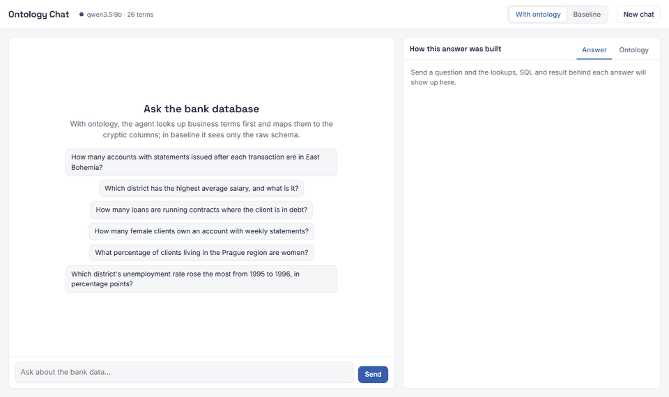
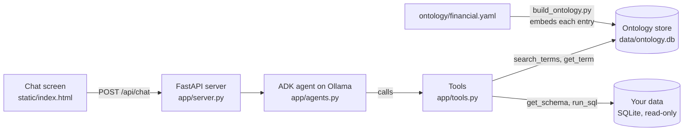

# Ontology Chat

**Same model, same question, two different answers.** Ontology Chat is an end-to-end working solution that shows what an ontology layer does for an AI agent that writes SQL: it tells the model what your columns and codes actually mean, so it stops guessing.



In the recording, the question is *"How many account owners who hold a gold credit card have a problem loan?"*

| Mode | Answer | Why |
|---|---|---|
| With ontology | **1** (correct) | Looked up "problem loan" and learned it means `loan.status IN ('B', 'D')` |
| Baseline | **8** (wrong) | Saw only the raw schema and guessed that status `C` is also a problem |

The full stack is included: a chat screen, a streaming API, a [Google ADK](https://google.github.io/adk-docs/) agent on an [Ollama](https://ollama.com/) model, embedding search over the ontology, and read-only SQL execution. No API keys are needed.

## Contents

- [How it works](#how-it-works)
- [Installation, step by step](#installation-step-by-step)
- [Using the app](#using-the-app)
- [Connect your own database](#connect-your-own-database)
- [Settings](#settings)
- [Project layout](#project-layout)
- [Troubleshooting](#troubleshooting)
- [Results and limits](#results-and-limits)
- [Credits](#credits)

## How it works



The ontology is a list of plain-language entries of three kinds:

| Kind | What it captures | Example from the demo |
|---|---|---|
| `term` | A business concept mapped to columns and coded values | "Average salary" is `district.A11` |
| `sql_attribute` | A calculation someone has reviewed | "Loan in good standing" is `loan.status IN ('A', 'C')` |
| `relationship` | How tables join | Clients reach accounts only through `disp` |

You write the entries in a YAML file. A build script embeds each one and stores it in a small SQLite database, so the ontology lives on disk, not in memory. At question time the agent searches that store, reads the entries it needs, then writes and runs SQL.

The two modes differ only in the tools the agent is given:

| Tool | With ontology | Baseline |
|---|---|---|
| `search_terms(query)`: find the 5 closest ontology entries | yes | no |
| `get_term(term_id)`: read one entry in full | yes | no |
| `get_schema()`: table and column names, no meanings | yes | yes |
| `run_sql(sql)`: one read-only query, up to 50 rows | yes | yes |

The demo data is the `financial` database from the [BIRD text-to-SQL benchmark](https://bird-bench.github.io/): a real Czech bank with 8 tables and about a million transactions. Its schema is hard to read on purpose. District columns are named `A2` to `A16`, and values are Czech codes such as `POPLATEK MESICNE` (monthly statements).

## Installation, step by step

Tested on Windows 11. The commands are the same on macOS and Linux.

### Step 1. Install the two prerequisites

| Tool | What it is for | Install |
|---|---|---|
| [uv](https://docs.astral.sh/uv/getting-started/installation/) | Installs Python 3.12 and the project's packages | Windows: `winget install astral-sh.uv` |
| [Ollama](https://ollama.com/download) | Runs the chat and embedding models | Download the installer from ollama.com |

You do not need to install Python yourself. `uv` downloads the right version.

Check both are available:

```
uv --version
ollama --version
```

### Step 2. Pull the models

```
ollama pull qwen3.5:9b
ollama pull bge-m3
```

This downloads about 8 GB. `qwen3.5:9b` is the chat model and `bge-m3` creates the embeddings. An 8 GB GPU is enough; it also runs on CPU, more slowly.

### Step 3. Get the code and install packages

```
git clone https://github.com/rickragv/ontology-layer.git
cd ontology-layer
uv sync
```

`uv sync` creates a `.venv` folder with Python 3.12 and every dependency.

### Step 4. Download the demo database

```
uv run python scripts/load.py
```

This downloads the BIRD dev set (about 350 MB), extracts the `financial` database into `data/`, and splits its 106 questions into `questions/build.json` and `questions/test.json`. It takes a few minutes. Running it again reuses the download.

### Step 5. Build the ontology store

```
uv run python scripts/build_ontology.py
```

This reads `ontology/financial.yaml`, embeds the 26 entries with `bge-m3`, and writes `data/ontology.db`. Expect a line like:

```
wrote data/ontology.db (26 entries, 1024-dim vectors)
```

### Step 6. Start the app

```
uv run uvicorn app.server:app --port 8765
```

Open **http://127.0.0.1:8765**. The dot next to the title should be green and read `qwen3.5:9b · 26 terms`.

The first question takes about 30 seconds longer than later ones, because Ollama loads the model into memory.

## Using the app

1. Click a suggested question, or type your own.
2. Watch the steps appear: which terms the agent searched, which it read, and each SQL run.
3. Read the right-hand panel: the terms used, every SQL query, and the result table.
4. Switch to **Baseline** and ask the same question to compare.
5. Open the **Ontology** tab to browse and search all entries.

Questions worth trying:

- `For loans approved in 1997 that are in good standing, show the number of loans and the average loan amount per region, sorted by average amount descending.`
- `Top 5 districts by total credited transaction amount in 1998 for accounts with monthly statements. Include each district's average salary.`
- `How many account owners who hold a gold credit card have a problem loan?`

## Connect your own database

The app works on any **SQLite** file. You point it at your file, describe your tables in a YAML ontology, and rebuild the store. No code changes are needed.

### Step 1. Have your data in a SQLite file

If your data is already SQLite, skip this. Otherwise export the tables you care about to CSV and load them:

```
sqlite3 mydata.sqlite
.mode csv
.import orders.csv orders
.import customers.csv customers
```

The app opens the file read-only and refuses anything except `SELECT`, so it cannot change your data.

### Step 2. Find what needs explaining

Look at real values before writing anything. Coded columns and ambiguous amounts are what a model gets wrong.

```sql
SELECT sts_cd, COUNT(*) FROM orders GROUP BY sts_cd;
SELECT MIN(ord_dt), MAX(ord_dt) FROM orders;
```

Make three lists: columns whose names or values need a definition, calculations people ask for by name, and how the tables join.

### Step 3. Write your ontology

Create `ontology/mydata.yaml`. Each list from step 2 becomes one kind of entry:

```yaml
entries:

  - id: order_status
    kind: term
    name: Order status
    description: >
      Stage of an order, stored in orders.sts_cd. 'O' = open, 'S' = shipped,
      'C' = cancelled, 'R' = returned. Codes are upper-case single letters.
    synonyms: [status, shipped, cancelled, returned, open orders]
    columns: [orders.sts_cd]
    sql: "orders.sts_cd = 'S'  -- shipped"

  - id: net_revenue
    kind: sql_attribute
    name: Net revenue
    description: >
      Order value after discount. Count only shipped orders. disc_amt can be
      NULL, treat it as 0.
    synonyms: [revenue, net sales, sales, turnover]
    columns: [orders.tot_amt, orders.disc_amt, orders.sts_cd]
    sql: "SUM(orders.tot_amt - COALESCE(orders.disc_amt, 0))"

  - id: order_to_customer
    kind: relationship
    name: Order to customer
    description: Each order belongs to one customer.
    synonyms: [customer of order, orders by customer, buyer]
    columns: [orders.cust_id, customers.cust_id]
    sql: "JOIN customers ON customers.cust_id = orders.cust_id"
```

Search looks only at `name`, `synonyms` and `description`, so put the words people actually say in `synonyms`. The `sql` and `columns` fields are what the agent copies once it has found the entry. See `ontology/financial.yaml` for 26 worked examples.

### Step 4. Point the app at your files

Set three environment variables. `DB_NOTES` is one or two sentences telling the agent what the database is.

PowerShell:

```powershell
$env:DB_PATH = "C:\path\to\mydata.sqlite"
$env:ONTOLOGY_YAML = "ontology\mydata.yaml"
$env:ONTOLOGY_DB = "data\mydata-ontology.db"
$env:DB_NOTES = "Order data for an online shop: tables orders and customers. Amounts are in INR."
```

macOS or Linux:

```bash
export DB_PATH=/path/to/mydata.sqlite
export ONTOLOGY_YAML=ontology/mydata.yaml
export ONTOLOGY_DB=data/mydata-ontology.db
export DB_NOTES="Order data for an online shop: tables orders and customers. Amounts are in INR."
```

### Step 5. Build and run

In the same terminal:

```
uv run python scripts/build_ontology.py
uv run uvicorn app.server:app --port 8765
```

### Step 6. Improve it from what you see

| What you see | What to change |
|---|---|
| The right entry is missing from the search results | Add the user's wording to `synonyms` |
| Found the entry, wrote the wrong filter | Spell out exact values and case in `description` and `sql` |
| Wrong join, or duplicate rows | Add or tighten a `relationship` entry |
| The same calculation written differently each time | Add a `sql_attribute` so there is one reviewed version |

Rerun `build_ontology.py` after every YAML change. The store is rebuilt from scratch each time.

### Postgres, MySQL and other databases

Only SQLite is supported today. To use another database, replace two functions in `app/tools.py`: `_financial_conn()`, which opens the connection, and `get_schema()`, which lists tables and columns. Connect with a read-only database user, because the statement checks in `run_sql` were written for SQLite. This path is not built or tested.

## Settings

All settings are environment variables. Every one has a default, so the demo runs with none set.

| Variable | Default | Meaning |
|---|---|---|
| `CHAT_MODEL` | `qwen3.5:9b` | Ollama chat model for the agent |
| `EMBED_MODEL` | `bge-m3` | Ollama embedding model |
| `OLLAMA_BASE_URL` | `http://127.0.0.1:11434` | Ollama address |
| `DB_PATH` | `data/financial.sqlite` | SQLite database the agent queries |
| `ONTOLOGY_YAML` | `ontology/financial.yaml` | Ontology source file |
| `ONTOLOGY_DB` | `data/ontology.db` | Built ontology store |
| `DB_NOTES` | A description of the bank database | What the agent is told about the database |

Rebuild the ontology store after changing `EMBED_MODEL`, because vectors from different models cannot be compared.

## Project layout

```
app/
  config.py            paths and settings
  tools.py             search_terms, get_term, get_schema, run_sql
  agents.py            the two ADK agents and their instructions
  server.py            FastAPI app and the streaming chat endpoint
ontology/
  financial.yaml       the ontology for the demo database (26 entries)
scripts/
  load.py              downloads the demo database
  build_ontology.py    embeds the YAML into the ontology store
static/
  index.html           the chat screen, one file, no build step
docs/
  demo.gif
```

The API, for building another client:

- `GET /api/health`, `GET /api/ontology`, `GET /api/suggestions`
- `POST /api/chat` with `{"session_id", "message", "mode": "ontology" | "baseline"}`. The response is a server-sent event stream of `tool_call`, `tool_result`, `text` and `error` events, ending with `done`.

## Troubleshooting

| Problem | Fix |
|---|---|
| Status dot is red, "Ollama unreachable" | Start Ollama (`ollama serve`, or open the Ollama app) |
| Status shows "Database unavailable" | Run `scripts/load.py`, or check `DB_PATH` |
| Status shows `0 terms` | Run `scripts/build_ontology.py` |
| `address already in use` on start | Another program holds the port. Use `--port 8770` |
| First answer is very slow | Normal. Ollama is loading the model |
| Page looks unchanged after an update | Hard refresh with Ctrl+Shift+R |
| Answers are worse with `qwen2.5:7b` | Expected. It skips tool calls more often. Use `qwen3.5:9b` |

## Results and limits

Measured with `qwen3.5:9b` on six questions from the build half:

| | Correct | Time per answer |
|---|---|---|
| With ontology | 6 of 6 | 8 to 31 seconds |
| Baseline | 0 of 6 | 45 seconds to 5 minutes |

Read these numbers with care:

- **Small sample.** Six questions, all from the half of the question set that was read while writing the ontology. Accuracy on the 53 held-out questions in `questions/test.json` has not been measured.
- **The model is not deterministic.** The same question can produce a different tool sequence on another run.
- **Always check the SQL panel.** A plausible answer can come from a wrong join. The SQL is how you catch it.
- **Sessions are in memory.** Conversation history is lost when the server restarts.

## Credits

- The idea follows [NVIDIA Auto Ontology](https://github.com/NVIDIA/auto-ontology), which generates and certifies an ontology over enterprise databases. This project is a small hand-written version of the same concept and does not use its code. The tool names `search_terms` and `get_term` match its MCP tools.
- The demo data comes from the [BIRD benchmark](https://bird-bench.github.io/). It is downloaded by `scripts/load.py` and is not included in this repository. Check BIRD's licence before redistributing it.
- Built with [Google ADK](https://google.github.io/adk-docs/), [LiteLLM](https://github.com/BerriAI/litellm), [FastAPI](https://fastapi.tiangolo.com/) and [Ollama](https://ollama.com/).
